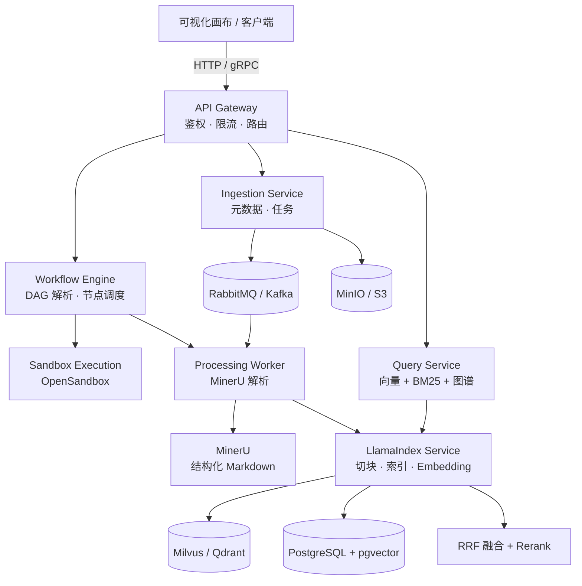

# NexusFlow

分布式文件向量化工作流：**Go 编排调度 + MinerU 解析 + LlamaIndex 数据加工 + OpenSandbox 执行**。

将 PDF / Word / TXT 等异构文件加工为可检索的向量与索引，提供多路召回、RRF 融合、Cross-Encoder 重排与自定义代码节点能力，服务下游 RAG 与语义检索场景。

完整设计见 [docs/architecture.md](docs/architecture.md)（系统架构设计文档 V4.0）。

> 说明：设计文档标题为 V4.0，正文部分沿用了 V2.0 的演进叙述（“V2.0 新增 LlamaIndex 服务”等），属于保留的历史上下文，不影响当前架构与代码结构。

## 架构总览



分层职责：

- **接入层**：Gateway 统一鉴权（JWT → tenant_id + 权限点）、租户级限流、trace 透传；Auth / User 服务负责签发令牌、管理账号与 RBAC。
- **编排调度层**：Workflow Engine 解析 DAG、按依赖并发调度；Ingestion 接收上传并投递任务。
- **执行加工层**：Processing Worker 调用 MinerU；LlamaIndex Service 负责语义/层级切块、索引与 Embedding；Sandbox Execution 经 OpenSandbox 执行自定义代码。
- **检索层**：Query Service 并行多路召回，RRF 融合，Cross-Encoder 重排，任一非核心路失败 Fail-open。
- **存储层**：MinIO 对象存储、Qdrant/Milvus 向量库、Redis 任务状态、PostgreSQL(+pgvector) 长期记忆。

## 服务与目录

| 服务 | 语言 | 目录 | 端口 | 职责 |
| --- | --- | --- | --- | --- |
| API Gateway | Go | `backend/cmd/gateway` | 8080 | 鉴权、限流、上传与检索入口 |
| Auth Service | Go | `backend/cmd/auth-service` | 9096 | 注册 / 登录 / 刷新 / 校验，签发 JWT |
| User Service | Go | `backend/cmd/user-service` | 9097 | 用户 CRUD、角色与权限（RBAC）管理 |
| Workflow Engine | Go | `backend/cmd/workflow-engine` | 8081 | DAG 校验与调度执行 |
| Ingestion Service | Go | `backend/cmd/ingestion` | 9095 | 上传登记、状态查询、任务投递 |
| Processing Worker | Go | `backend/cmd/processing-worker` | 9092 | 消费任务、调用 MinerU、发布解析结果 |
| Sandbox Execution | Go | `backend/cmd/sandbox-execution` | 9093 | 自定义代码节点强隔离执行 |
| Query Service | Go | `backend/cmd/query-service` | 9094 | 多路召回、RRF、重排、流式回答 |
| LlamaIndex Service | Python | `services/llamaindex` | 8000 | 切块、索引、Embedding、检索策略 |
| RAG Agent | Python | `services/rag-agent` | 8001 | LangGraph 多轮问答、意图路由、引用、会话持久化 |
| Intent Agent | Python | `services/intent-agent` | 8002 | 独立意图识别服务（Supervisor 第一步），LLM + 规则降级 |
| Web Console | React | `web` | 5173 / 8088 | 控制台：文件管理 / 任务中心 / 检索 / 沙箱 / DAG 编排 |

```text
.
├── proto/vectorization/v1/        # Protobuf 契约（跨语言唯一事实来源）
├── backend/
│   ├── cmd/                       # 7 个可执行入口（含单进程 dev-all）
│   ├── internal/
│   │   ├── gateway/               # 鉴权、限流、HTTP 路由
│   │   ├── workflow/              # DAG 校验、拓扑调度、节点注册
│   │   ├── ingestion/             # 上传登记与任务投递
│   │   ├── processing/            # MinerU 解析 Worker
│   │   ├── sandbox/               # Local / OpenSandbox 双后端
│   │   ├── query/                 # 召回、RRF、Rerank
│   │   ├── state/                 # 状态机（memory / Redis）
│   │   ├── queue/                 # 消息总线（memory / RabbitMQ）
│   │   └── platform/              # 日志、指标、HTTP/gRPC 服务封装
│   └── pb/                        # protoc 生成代码
├── services/llamaindex/           # FastAPI + LlamaIndex 数据加工服务
├── services/rag-agent/            # FastAPI + LangGraph 多轮 RAG 问答服务
├── services/intent-agent/         # FastAPI + LangGraph 意图识别服务（独立部署）
├── web/                           # React + TS 控制台（路由 + 多页面 + React Flow）
├── deploy/
│   ├── docker-compose.yml         # 完整本地编排
│   ├── k8s/nexusflow.yaml         # K8s 部署 + HPA 自定义指标
│   └── prometheus/                # 指标抓取配置
├── docs/architecture.md           # 架构设计文档（V4.0）
└── Makefile
```

## 快速开始

### 1. 单进程跑通全链路

无需任何外部依赖，单进程即启动 Gateway（:8080）、Workflow Engine（:8081）与全部 gRPC 服务，使用内存消息总线 + Mock MinerU：

```bash
make run-dev-all
```

然后：

```bash
# 1) 上传真实文件（multipart）——文件写入对象存储并登记任务
curl -s http://127.0.0.1:8080/v1/files -F "file=@./README.md"

# 或仅登记元数据（文件由客户端直传对象存储时使用）
curl -s http://127.0.0.1:8080/v1/files \
  -H 'Content-Type: application/json' \
  -d '{"file_name":"demo.pdf","file_type":"pdf","file_size":1024}'

# 2) 任务列表（按状态过滤 / 分页）
curl -s "http://127.0.0.1:8080/v1/tasks?limit=20"

# 3) 单个任务状态（task_id 换成上一步返回值）
curl -s http://127.0.0.1:8080/v1/tasks/<task_id>

# 4) 检索（内置演示语料）
curl -s http://127.0.0.1:8080/v1/search \
  -H 'Content-Type: application/json' \
  -d '{"query":"三路召回如何融合？","routes":[{"type":"vector","top_k":20},{"type":"bm25","top_k":20}],"final_top_n":5}'

# 5) 沙箱执行自定义代码（输入/输出走 /tmp/input.json、/tmp/output.json）
curl -s http://127.0.0.1:8080/v1/sandbox/execute \
  -H 'Content-Type: application/json' \
  -d '{"code":"print(1+2)","runtime":"python","timeout_seconds":10}'
```

DAG 校验与试运行：

```bash
curl -s http://127.0.0.1:8081/v1/workflows/validate \
  -H 'Content-Type: application/json' \
  -d '{"dag":{"name":"demo","nodes":[{"id":"ingest","type":"ingest"},{"id":"parse","type":"parse"}],"edges":[{"from":"ingest","to":"parse"}]}}'
```

### 2. 前端控制台

```bash
make web-install
make web-dev        # http://localhost:5173
```

控制台通过 Vite 代理连接 Gateway（`/api`）与 Workflow Engine（`/wf`），包含以下页面：

| 页面 | 路径 | 功能 |
| --- | --- | --- |
| 登录 / 注册 | `/login` | 账号密码登录、自助注册、匿名浏览 |
| 概览 | `/` | 任务统计、最近任务、快捷入口 |
| 文件管理 | `/files` | 拖拽/点击上传文件，查看处理状态 |
| 任务中心 | `/tasks` | 任务列表、状态过滤、自动轮询、详情 |
| 检索测试 | `/search` | 多路召回检索、赞/踩反馈与链路分解 |
| 智能问答 | `/chat` | 多轮 RAG 问答、过程节点、检索知识、正文引用一键跳转 |
| 用户管理 | `/users` | 用户 CRUD、角色与权限点管理（需 `user:read`） |
| 沙箱 Playground | `/sandbox` | 自定义代码执行与输入/输出合约调试 |
| 工作流编排 | `/workflow` | 拖拽节点、连线、DAG 校验与试运行 |

访问控制台会跳转 `/login`：用种子管理员 `admin / admin123` 登录，或自助注册（默认 viewer 角色），也可点"以匿名身份浏览"（需 `ALLOW_ANONYMOUS=true`）。登录后右上角显示当前身份与登出按钮，拥有 `user:read` 的用户可见"用户管理"入口。

### 3. 完整容器编排

```bash
cp .env.example .env
make up
```

| 入口 | 地址 |
| --- | --- |
| Web 画布 | http://localhost:8088 |
| Gateway API | http://localhost:8080 |
| Workflow Engine | http://localhost:8081 |
| LlamaIndex Service | http://localhost:8000 |
| RAG Agent | http://localhost:8001 |
| RabbitMQ 控制台 | http://localhost:15672 |
| Prometheus / Grafana | http://localhost:9090 / http://localhost:3000 |

容器编排使用 `STATE_DRIVER=redis`、`QUEUE_DRIVER=rabbitmq`，服务间通过 gRPC 与消息队列解耦。

## 核心机制

**任务状态机**（`backend/internal/state`）：

```text
PENDING → FETCHED → PARSING → PARSED → CHUNKED → EMBEDDED → INDEXED → COMPLETED
                                   ↘ FAILED（重试耗尽进 DLQ）

自定义节点：SANDBOX_CREATING → SANDBOX_RUNNING → SANDBOX_DONE → 并入主链路
```

消费端以 `task_id + content_hash` 为幂等键，避免重复解析与重复向量化。

**DAG 引擎**（`backend/internal/workflow`）：校验节点类型、引用完整性与环路，按拓扑层级并发执行就绪节点，上游输出写入共享 `ExecutionContext`。

**检索链路**（`backend/internal/query`）：多路召回并行执行 → RRF 融合（k=60）→ 去重 → Cross-Encoder 重排 → 取 top-N；单路失败或重排超时自动降级为 RRF 结果。

**沙箱护栏**（`backend/internal/sandbox`）：强制 TTL、`defer` 无条件销毁、输入/输出走约定文件、出口白名单与凭据不落盘。`local` 后端仅用于本机调试，生产必须使用 `remote`（OpenSandbox）。

## 用户与认证（RBAC）

认证与账号管理拆成两个独立 gRPC 服务（`identity.proto` 契约）：

- **Auth Service（:9096）**：`Register` / `Login` / `Refresh` / `Logout` / `Validate`，负责密码校验与 JWT 签发。
- **User Service（:9097）**：租户隔离的用户 CRUD，以及全局角色、权限点的管理。

**令牌模型**：HS256 JWT，claims 携带 `tenant_id` / `user_id` / `roles` / `permissions` / `token_type`。access token 默认 15 分钟（`ACCESS_TOKEN_TTL`），refresh token 默认 168 小时（`REFRESH_TOKEN_TTL`）；`token_type` 区分用途，refresh token 不能当 access 用。权限点在登录时由角色展开并写入 token，网关据此零开销判定，无需每次回调鉴权服务。控制台在 access token 过期（401）时用 refresh token 自动换新并重试原请求，刷新失败则清理登录态并回到 `/login`。

**存储**：`IDENTITY_DRIVER=memory`（默认，dev-all 单进程）或 `redis`（独立部署时 Auth / User 服务共享同一份用户与角色数据）。

**权限模型**：固定权限点目录（`user:read`、`file:write`、`sandbox:execute`、`trace:read` 等 14 个 + 通配 `*`）→ 角色组合 → 用户绑定角色。内置三个角色：

| 角色 | 权限 | 说明 |
| --- | --- | --- |
| `admin` | `*` | 全量权限 |
| `editor` | 文件/任务读写、检索、沙箱、工作流、trace、user:read | 内容编辑者 |
| `viewer` | 文件/任务只读、检索、trace | 只读访客 |

内置角色不可修改删除；自定义角色可自由组合权限点。

**HTTP 端点**（Gateway 暴露）：

| 方法 | 路径 | 鉴权 | 说明 |
| --- | --- | --- | --- |
| POST | `/v1/auth/register` | 公开 | 自助注册（`ALLOW_SELF_REGISTER` 可关），默认分配 viewer |
| POST | `/v1/auth/login` | 公开 | 用户名 + 密码 → 令牌对 + 用户信息 |
| POST | `/v1/auth/refresh` | 公开 | refresh token 换新令牌对 |
| POST | `/v1/auth/logout` | 需登录 | 无状态登出（生产可接吊销名单） |
| GET/POST | `/v1/users` | `user:read` / `user:write` | 列表 / 创建 |
| GET/PATCH/DELETE | `/v1/users/:id` | `user:read` / `user:write` / `user:delete` | 详情 / 更新 / 删除 |
| GET/POST | `/v1/roles` | `role:read` / `role:write` | 角色列表 / 新建或更新 |
| DELETE | `/v1/roles/:name` | `role:write` | 删除自定义角色 |
| GET | `/v1/permissions` | `role:read` | 权限点目录 |

首次启动会自动种子管理员：`admin / admin123`（可用 `SEED_ADMIN_*` 覆盖）。控制台 `/login` 登录后，`admin` 可在"用户管理"页创建账号、分配角色、启停用户，并新建自定义角色。未登录可点"以匿名身份浏览"（需 `ALLOW_ANONYMOUS=true`），匿名身份仅有 `search:use`，可使用检索与智能问答，但无任何管理权限。

## RAG 对话服务（LangGraph）

`services/rag-agent` 打通「用户身份」与「检索」，提供多轮问答、答案引用与会话历史；意图识别拆分为独立的 `services/intent-agent`，通过 HTTP 通信：

- **身份联动**：网关校验 JWT 后将 `x-tenant-id` / `x-user-id` / `Authorization` 透传给 rag-agent；会话与消息按「租户 + 用户」隔离，匿名调用者落在 `default/anonymous`。
- **意图路由（multi-agent 第一步）**：rag-agent 调用独立 intent-agent（`RAG_INTENT_URL`）做 `knowledge_qa | chitchat | clarify` 分类；`chitchat` / `clarify` 跳过检索直接回答，服务不可用时降级为知识问答。
- **检索复用**：rag-agent 通过 `RAG_GATEWAY_URL` 调用网关 `/v1/search`，复用统一的多路召回 + RRF + 重排链路与 trace，而不是自建第二套检索。
- **LangGraph 生成**：`retrieve → generate` 两节点状态图；配置 `RAG_LLM_BASE_URL` + `RAG_LLM_API_KEY`（OpenAI 兼容）时调用大模型，未配置时降级为抽取式片段摘要，保证无 Key 也能演示。
- **流式过程事件**：`/v1/chat/stream` 以 SSE 依次推送 `stage(intent) → intent → stage(retrieve) → sources → stage(generate) → token* → done`；控制台据此渲染「意图 → 检索 → 生成 → 回答」节点、检索知识面板，并支持正文 `[n]` 标记点击跳转到对应来源。非检索意图的「检索」节点显示为跳过。
- **会话存储**：`RAG_DATABASE_URL` 指向 Postgres 时持久化到 `rag_conversations` / `rag_messages`；为空则使用进程内存储（仅开发）。

本地运行（先启动 dev-all 提供网关与检索，再分别启动两个 Python 服务）：

```bash
# 终端 1：Go 全链路（含 Gateway :8080 与查询服务）
make run-dev-all

# 终端 2：意图识别服务（无 Key 时走规则）
cd services/intent-agent
pip install -e ".[test]"
uvicorn app.main:app --port 8002

# 终端 3：RAG agent（内存会话 + 抽取式回答）
cd services/rag-agent
pip install -e ".[dev]"
RAG_GATEWAY_URL=http://127.0.0.1:8080 \
RAG_INTENT_URL=http://127.0.0.1:8002 \
uvicorn app.main:app --port 8001
```

接入 DeepSeek（OpenAI 兼容，两个服务分别配置）：

```bash
RAG_LLM_BASE_URL=https://api.deepseek.com/v1
RAG_LLM_API_KEY=sk-...
RAG_LLM_MODEL=deepseek-chat
INTENT_LLM_BASE_URL=https://api.deepseek.com/v1
INTENT_LLM_API_KEY=sk-...
INTENT_LLM_MODEL=deepseek-chat
```

网关端点（`RAG_AGENT_URL` 为空会关闭代理）：

| 方法 | 路径 | 鉴权 | 说明 |
| --- | --- | --- | --- |
| POST | `/v1/chat` | `search:use` | 提问 `{message, conversation_id?, top_k?, kb_id?}`，返回答案 + 引用 |
| POST | `/v1/chat/stream` | `search:use` | 同上，SSE 流式返回过程事件与回答 |
| GET | `/v1/conversations` | `search:use` | 当前用户的会话列表（分页） |
| GET | `/v1/conversations/:id` | `search:use` | 会话详情（消息 + 引用） |

### 多智能体路线

| 阶段 | 服务 | 内容 | 状态 |
| --- | --- | --- | --- |
| P1 | `intent-agent` :8002 | 意图识别与路由（`knowledge_qa / chitchat / clarify`），LLM + 规则降级 | 已完成 |
| P2 | `summary-agent` :8003 | 上下文总结、自动压缩（滚动摘要 + 最近 N 轮），按字符预算裁剪 | 规划中 |
| P3 | `memory-agent` :8004 | 长期记忆抽取、去重合并、召回注入；Postgres + pgvector | 规划中 |

P2/P3 约定：

- 各 agent 独立部署、通过 HTTP 通信；rag-agent 保留 Supervisor 编排职责，新增 `RAG_SUMMARY_URL` / `RAG_MEMORY_URL` 接入。
- 摘要写入 `rag_conversations.summary`，prompt 使用「摘要 + 最近 N 轮原文」；引用不因压缩丢失。
- 记忆表 `rag_memories` 使用 pgvector（镜像切换为 `pgvector/pgvector:pg16` 并启用 `CREATE EXTENSION vector`），按 `tenant_id + user_id` 隔离；对话开始召回 top-k 注入，轮次结束异步抽取。
- 所有 agent 统一使用 OpenAI 兼容配置（`RAG_LLM_*` / `INTENT_LLM_*`），DeepSeek 可直接接入。

## 反馈与评审

- **问答页反馈**：每条回答支持「有帮助 / 没帮助」，提交时携带 `trace_id`、`conversation_id`、`message_id`、query、answer、引用 chunk 与意图标签；点击正文 `[n]` 引用同时上报 `user.citation_click` 隐式正反馈。
- **检索页反馈**：保留赞/踩，落库的同时旁路写入 trace score（Langfuse 可用时）。
- **持久化**：`FEEDBACK_DRIVER=memory|postgres`。Postgres 启动时自动建 `rag_feedback` 表，按 `tenant_id + user_id + subject_id + name` 覆盖更新，同一消息只保留最新评分；生产 compose 默认 `postgres`，即使 tracing 为 Noop 也不会丢数据。
- **评审查询**：`GET /v1/feedback?rating=-1&limit=20`（需 `user:read`，按租户隔离），返回 query/answer/引用/纠正答案等字段。
- **尚未完成**：离线 golden set 与 `Recall@k / nDCG / faithfulness` 指标、低分自动归因、反馈驱动 rerank/prompt 的闭环（见多智能体路线 P2/P3）。

## RAG 离线评测

`eval/rag_eval.py` 仅依赖 Python 标准库，用 golden 集调用网关 `/v1/search`（可选 `/v1/chat`）并输出指标；低于 `eval/thresholds.json` 时进程退出码为 1，可直接接入 CI。

| 指标 | 含义 |
| --- | --- |
| `recall_at_k` | top-k 命中的相关条目数 / 标注相关数 |
| `mrr` | 首个相关结果排名的倒数均值 |
| `ndcg_at_k` | 二值相关性 nDCG@k |
| `citation_validity` | 引用中 `chunk_id` 非空的比例（`--with-chat`） |
| `citation_hit_rate` | 至少命中一个标注相关条目的回答占比（`--with-chat`） |
| `inline_marker_rate` | 有引用的回答中正文包含 `[n]` 的比例（`--with-chat`） |

```bash
# 先启动 dev-all；基于 3 条种子文档的示例集默认 k=2
make eval-rag

# 追加问答引用指标（需同时启动 rag-agent 与 intent-agent）
make eval-rag-chat
```

用例格式（`eval/golden.jsonl`，每行一个）：

```json
{"query": "多路召回如何做 RRF 融合和精排？", "relevant_ids": ["doc-2"], "kb_id": null}
```

`relevant_ids` 可匹配 `chunk_id` 或 `meta.doc_id / document_id / file_name`。真实语料库建议 `--k 5` 并同步调整阈值；报告写入 `eval/report.json`（已忽略提交）。当前生成侧只做规则校验，LLM-as-judge 的 faithfulness/relevancy 尚未接入。

## 安全与可靠性加固

- **上传**：仅接受 pdf/docx/txt/md/html；空文件与超限（100 MiB → 413）前置拒绝；`object_key`/`file_url`/`content_hash` 等保留元数据由服务端写入，客户端表单/JSON 无法伪造；内容去重命中时删除刚落盘的孤儿对象。
- **SSRF 防护**：JSON 直传的 `presigned_url` 仅允许 `OBJECT_STORE_ALLOWED_HOSTS`（缺省取 `OBJECT_STORE_BASE` 的 host）中的 http/https 主机，`file://` 等一律拒绝。
- **队列**：RabbitMQ 每个消费者独占 channel（规避 amqp.Channel 非并发安全）、prefetch=10、`x-retry` 计数超过 5 次转入 `<topic>.dlq`；MemoryBus 失败回调记录日志。
- **一致性**：建任务/重试时投递失败会回滚为 FAILED（不再滞留 PENDING）；索引阶段支持从 Chunked/Embedded/Indexed 断点续推，仅 COMPLETED 跳过。
- **检索上下文**：拼接进 prompt 的检索内容截断至 32 KiB 并用 `<<<CONTEXT` 分隔、显式声明为不可信资料，以缓解提示词注入（非完全防护）。

## 可观测性（Tracing / Langfuse）

检索与问答链路全程埋点（`backend/internal/platform/tracing`），统一抽象 `Tracer` / `Span`；`trace_id` 经 HTTP 头 `x-trace-id` 传入并透传到下游 gRPC（metadata `x-trace-id`），同一次请求的所有 span 挂在同一 trace 下。

三种后端实现，由环境变量选择（`tracing.NewFromEnv`）：

| 实现 | 触发条件 | 用途 |
| --- | --- | --- |
| `MemoryTracer` | `APP_ENV=dev` 或 `TRACING_MEMORY=true` | 进程内保留最近 500 条 trace，驱动控制台"链路分解"面板 |
| `LangfuseTracer` | `LANGFUSE_BASE_URL` 非空 | 批量导出到 Langfuse（`trace-create` / `span-create` / `score-create`），Basic 鉴权，2s 或满 50 条触发 flush |
| `NoopTracer` | 默认 | 零开销，不记录也不导出 |

埋点覆盖：

- **检索**（`query.Engine.Search`）：root `query.search` → 每路并行 `recall.<name>` → `fusion.rrf` → `rerank`；每个 span 记录耗时、状态与各阶段 count，单路失败标记为 `error` 但不阻断整体降级。
- **问答**（`query.GRPCService.Answer`）：`answer.generate` span 记录所用 prompt 的 `name` / `version`（版本化 prompt 注册表 `internal/platform/prompt`）。
- **用户反馈**：`POST /v1/feedback` 以 score 形式挂到指定 trace；控制台检索页的赞 / 踩按钮与"链路分解"面板（`GET /v1/traces/:id`）消费这些数据。

> Langfuse 导出为 fail-open：导出失败仅记录 warn 日志并丢弃该批次，不影响业务请求。

开发态查看：启动 `cmd/dev-all` 后进入检索页，执行一次搜索即可在"链路分解"面板看到 span 树与耗时分解；`GET /v1/traces` 列出最近 trace。生产启用 Langfuse 只需在 `.env` 填入：

```bash
LANGFUSE_BASE_URL=https://your-langfuse.example.com
LANGFUSE_PUBLIC_KEY=pk-lf-...
LANGFUSE_SECRET_KEY=sk-lf-...
```

## 开发者命令

```bash
make proto         # 重新生成 Go protobuf / gRPC 代码
make build         # 编译全部 Go 包
make test          # Go + Python 测试
make vet           # go vet
make web-build     # 前端类型检查与生产构建
make up / down     # 容器编排启停
```

## 当前实现边界

- `MINERU_TARGET` 为空时使用内置 Mock 解析器；对 txt/md/csv/json 等文本类文件会回显真实内容，使"上传 → 检索"闭环可演示。接入真实 MinerU 只需配置该地址。
- 单进程 dev-all 模式下，上传文件经解析、切块后写入共享内存索引（DocStore），检索可命中真实上传内容，任务状态推进至 COMPLETED。RRF 融合与重排逻辑与生产一致；生产将内存召回器替换为 Qdrant/Milvus 即可。
- LlamaIndex Service 的切块、索引与检索依赖 Qdrant 与 Embedding API Key；未配置时相关接口返回 503。
- K8s HPA 使用自定义指标 `nexusflow_queue_length`，需部署 prometheus-adapter 将指标转换为 Custom Metrics API。
- 设计文档中的 LightRAG、NL2SQL、长期记忆章节属于目标架构，当前代码骨架预留了对应扩展位，尚未实现端到端链路。（可观测性 / Langfuse 导出与 dev trace viewer 已实现，见上节。）
- 用户与角色支持两种存储：`memory`（dev-all 单进程默认）与 `redis`（`IDENTITY_DRIVER=redis`，供独立部署的 Auth / User 服务跨进程共享）。PostgreSQL 存储尚未实现，可扩展 `identity.Store` 接口接入。
- 登出为无状态实现（不吊销已签发的 JWT），refresh token 到期自然失效；生产环境如需即时失效需引入令牌吊销名单。
