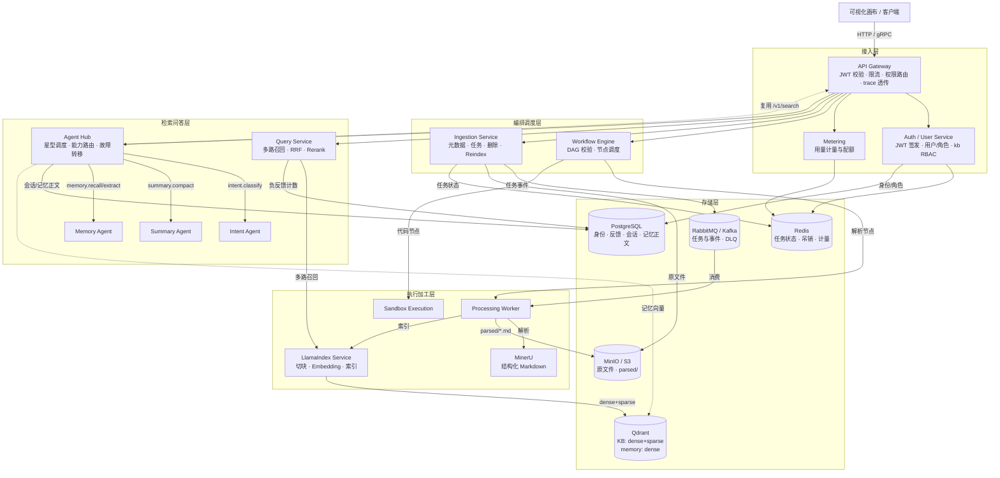
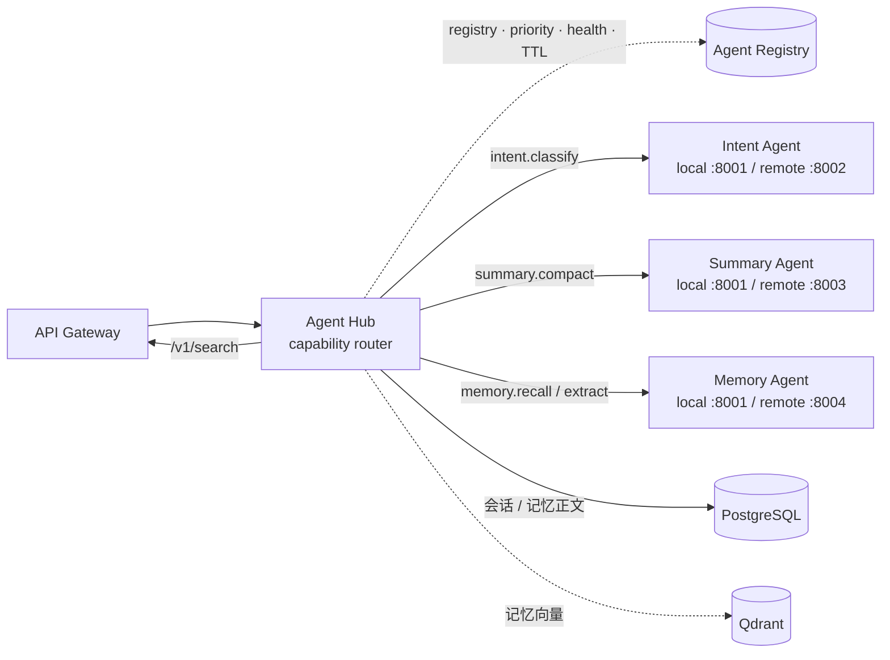

# NexusFlow

分布式文件向量化工作流：**Go 编排调度 + MinerU 解析 + LlamaIndex 数据加工 + Agent Hub 多智能体 + OpenSandbox 执行**。

将 PDF / Word / TXT 等异构文件加工为可检索的向量与索引，提供多路召回、RRF 融合、Cross-Encoder 重排与自定义代码节点能力，服务下游 RAG 与语义检索场景。

完整设计见 [docs/architecture.md](docs/architecture.md)（系统架构设计文档 V4.0）。

> 说明：设计文档标题为 V4.0，正文部分沿用了 V2.0 的演进叙述（“V2.0 新增 LlamaIndex 服务”等），属于保留的历史上下文，不影响当前架构与代码结构。

## 架构总览



分层职责：

- **接入层**：Gateway 统一鉴权（JWT → tenant_id + 权限点）、租户级限流、trace 透传；Auth / User 服务负责签发令牌、管理账号与全局角色，并按知识库解析 `kb:admin` / `kb:editor` / `kb:viewer` 权限；Metering 负责租户用量与配额。
- **编排调度层**：Workflow Engine 解析 DAG、按依赖并发调度；Ingestion 接收上传、级联删除并投递任务，Reindex 复用已持久化的解析产物。
- **执行加工层**：Processing Worker 调用 MinerU 解析并把 Markdown 持久化为 `tenant/kb/parsed/<task>.md`；LlamaIndex Service 负责语义/层级切块、索引与 Embedding；Sandbox Execution 经 OpenSandbox 执行自定义代码。
- **检索问答层**：Query Service 并行多路召回，RRF 融合，Cross-Encoder 重排，任一非核心路失败 Fail-open；Agent Hub 作为星型调度中心，按 capability 路由到 intent / summary / memory，经 Gateway 复用统一检索链路。
- **存储层**：RabbitMQ/Kafka 消息与 DLQ、MinIO 原文件与解析产物、Qdrant 文档向量（dense/sparse）与记忆向量（dense）、PostgreSQL 身份/反馈/会话/记忆正文、Redis 任务状态、计量与令牌吊销。

## 服务与目录

| 服务 | 语言 | 目录 | 端口 | 职责 |
| --- | --- | --- | --- | --- |
| API Gateway | Go | `backend/cmd/gateway` | 8080 | 鉴权、限流、上传与检索入口 |
| Auth Service | Go | `backend/cmd/auth-service` | 9096 | 注册 / 登录 / 刷新 / 校验，签发 JWT |
| User Service | Go | `backend/cmd/user-service` | 9097 | 用户 CRUD、角色与权限（RBAC）管理 |
| Workflow Engine | Go | `backend/cmd/workflow-engine` | 8081 | DAG 校验与调度执行 |
| Ingestion Service | Go | `backend/cmd/ingestion` | 9095 | 上传登记、状态查询、任务投递 |
| Processing Worker | Go | `backend/cmd/processing-worker` | 9092 | 消费任务、调用 MinerU、发布解析结果 |
| Sandbox Execution | Go | `backend/cmd/sandbox-execution` | 9093 | 自定义代码节点强隔离执行 |
| Query Service | Go | `backend/cmd/query-service` | 9094 | 多路召回、RRF、重排、流式回答 |
| LlamaIndex Service | Python | `services/llamaindex` | 8000 | 切块、索引、Embedding、检索策略 |
| Agent Hub | Python | `services/agent-hub` | 8001（拆分 8002–8004） | 星型调度 + RAG 多轮问答；默认单容器内置 intent / summary / memory，可用 `ROLE` 拆分 |
| Web Console | React | `web` | 5173 / 8088 | 控制台：知识库切换与授权 / 文件 / 任务 / 检索 / 问答 / 沙箱 / DAG |

```text
.
├── proto/vectorization/v1/        # Protobuf 契约（跨语言唯一事实来源）
├── backend/
│   ├── cmd/                       # 9 个可执行入口（含单进程 dev-all）
│   ├── internal/
│   │   ├── gateway/               # 鉴权、限流、HTTP 路由
│   │   ├── workflow/              # DAG 校验、拓扑调度、节点注册
│   │   ├── ingestion/             # 上传登记与任务投递
│   │   ├── processing/            # MinerU 解析 Worker
│   │   ├── sandbox/               # Local / OpenSandbox 双后端
│   │   ├── query/                 # 召回、RRF、Rerank
│   │   ├── identity/              # 用户/角色、知识库与 kb 级权限
│   │   ├── metering/              # 租户用量计量与配额（memory / Redis）
│   │   ├── state/                 # 状态机（memory / Redis）
│   │   ├── queue/                 # 消息总线（memory / RabbitMQ）
│   │   └── platform/              # 日志、指标、HTTP/gRPC 服务封装
│   └── pb/                        # protoc 生成代码
├── services/llamaindex/           # FastAPI + LlamaIndex 数据加工服务
├── services/agent-hub/            # 单容器多 Agent：RAG + intent/summary/memory + 星型调度
│   └── src/nexusflow_agents/      # agents/*（业务）、core/{registry,hub,executor}（调度）
├── web/                           # React + TS 控制台（路由 + 多页面 + React Flow）
├── deploy/
│   ├── docker-compose.yml         # 完整本地编排
│   ├── k8s/nexusflow.yaml         # K8s 部署 + HPA 自定义指标
│   ├── opensandbox/               # OpenSandbox server（Docker 模式）示例配置
│   └── prometheus/                # 指标抓取配置
├── docs/architecture.md           # 架构设计文档（V4.0）
├── docs/deployment.md             # Kubernetes 生产部署指南
├── docs/schema_enterprise_v1_1_to_1_5.sql  # 企业版增量 DDL
└── Makefile
```

## 快速开始

### 1. 单进程跑通全链路

无需任何外部依赖，单进程即启动 Gateway（:8080）、Workflow Engine（:8081）与全部 gRPC 服务，使用内存消息总线 + Mock MinerU：

```bash
make run-dev-all
```

然后：

```bash
# 1) 上传真实文件（multipart）——文件写入对象存储并登记任务
curl -s http://127.0.0.1:8080/v1/files -F "file=@./README.md"

# 或仅登记元数据（文件由客户端直传对象存储时使用）
curl -s http://127.0.0.1:8080/v1/files \
  -H 'Content-Type: application/json' \
  -d '{"file_name":"demo.pdf","file_type":"pdf","file_size":1024}'

# 2) 任务列表（按状态过滤 / 分页）
curl -s "http://127.0.0.1:8080/v1/tasks?limit=20"

# 3) 单个任务状态（task_id 换成上一步返回值）
curl -s http://127.0.0.1:8080/v1/tasks/<task_id>

# 4) 检索（内置演示语料）
curl -s http://127.0.0.1:8080/v1/search \
  -H 'Content-Type: application/json' \
  -d '{"query":"三路召回如何融合？","routes":[{"type":"vector","top_k":20},{"type":"bm25","top_k":20}],"final_top_n":5}'

# 5) 沙箱执行自定义代码（输入/输出走 /tmp/input.json、/tmp/output.json）
curl -s http://127.0.0.1:8080/v1/sandbox/execute \
  -H 'Content-Type: application/json' \
  -d '{"code":"print(1+2)","runtime":"python","timeout_seconds":10}'
```

DAG 校验与试运行：

```bash
curl -s http://127.0.0.1:8081/v1/workflows/validate \
  -H 'Content-Type: application/json' \
  -d '{"dag":{"name":"demo","nodes":[{"id":"ingest","type":"ingest"},{"id":"parse","type":"parse"}],"edges":[{"from":"ingest","to":"parse"}]}}'
```

### 2. 前端控制台

```bash
make web-install
make web-dev        # http://localhost:5173
```

控制台通过 Vite 代理连接 Gateway（`/api`）与 Workflow Engine（`/wf`），包含以下页面：

| 页面 | 路径 | 功能 |
| --- | --- | --- |
| 登录 / 注册 | `/login` | 账号密码登录、自助注册、匿名浏览 |
| 概览 | `/` | 任务统计、租户存储/文件/问答配额卡片、最近任务 |
| 文件管理 | `/files` | 按知识库上传、查看状态、级联删除与重建索引（viewer 只读） |
| 任务中心 | `/tasks` | 任务列表、状态过滤、自动轮询、详情 |
| 检索测试 | `/search` | 多路召回检索、赞/踩反馈与链路分解 |
| 智能问答 | `/chat` | 多轮 RAG 问答、过程节点、检索知识、正文引用一键跳转 |
| 用户管理 | `/users` | 用户 CRUD、角色与权限点管理（需 `user:read`） |
| 沙箱 Playground | `/sandbox` | 自定义代码执行与输入/输出合约调试 |
| 工作流编排 | `/workflow` | 拖拽节点、连线、DAG 校验与试运行 |

访问控制台会跳转 `/login`：用种子管理员 `admin / admin123` 登录，或自助注册（默认 viewer 角色），也可点"以匿名身份浏览"（需 `ALLOW_ANONYMOUS=true`）。登录后右上角显示当前身份、知识库切换器与当前库角色（管理员/编辑者/只读），拥有 `user:read` 的用户可见"用户管理"入口；知识库管理员可在"管理"弹窗中改名、删除与授权成员。

### 3. 完整容器编排

```bash
cp .env.example .env
make up
```

`make up` 会自动加载根目录 `.env`（gitignored）。端口冲突时可在 `.env` 覆盖 `GATEWAY_PUBLISH_PORT`（默认 8080）与 `POSTGRES_PUBLISH_PORT`（默认 5432）；MinIO / Prometheus / Grafana 属于可选 `extras` profile，需要时用 `docker compose --profile extras ...` 启用。

| 入口 | 地址 |
| --- | --- |
| Web 画布 | http://localhost:8088 |
| Gateway API | http://localhost:8080 |
| Workflow Engine | http://localhost:8081 |
| LlamaIndex Service | http://localhost:8000 |
| MinerU API（独立容器） | http://localhost:18000 |
| Agent Hub | http://localhost:8001 |
| RabbitMQ 控制台 | http://localhost:15672 |
| Prometheus / Grafana | http://localhost:9090 / http://localhost:3000 |

容器编排使用 `STATE_DRIVER=redis`、`QUEUE_DRIVER=rabbitmq`，服务间通过 gRPC 与消息队列解耦。每个业务容器均提供 `/healthz`（Go 服务在 `METRICS_ADDR=:9100` 上同时暴露 `/metrics`，gateway/workflow/web 用各自 HTTP 端口），`docker compose` 依据健康检查状态控制启动顺序（如 gateway 等待 auth/user/ingestion/query/sandbox/agent-hub 健康后再启动）。

生产集群部署（PVC、HPA 自定义指标与配额）见 [docs/deployment.md](docs/deployment.md)。

### 4. 真实 MinerU 4.x 与真机冒烟

真实解析使用 **MinerU 4.x 官方 V1 Tasks API**。按[官方 Docker 部署文档](https://opendatalab.github.io/MinerU/zh/quick_start/docker_deployment/)构建镜像时，建议固定 `mineru[torch]==4.2.3`，不要依赖可变的 `>=4.0,<5` 安装区间。当前 `vLLM 0.21.0` 基础镜像还需将 `transformers` 固定为 `>=5.10.1,<5.23.0`；本次验证版本为 `5.22.2`。镜像内应预下载 standard 的 Torch 小模型与 vLLM 权重。

已有 `mineru:4.2.3` 镜像后，启动独立 API 容器（宿主端口避开 LlamaIndex 的 8000）：

```bash
docker run -d --name mineru-api \
  --network nexusflow_default \
  -p 18000:8000 \
  --gpus all --ipc=host --shm-size=8g \
  --restart unless-stopped \
  mineru:4.2.3 \
  mineru-kit api-server --host 0.0.0.0 --port 8000 --tier standard
```

在根目录 `.env` 配置并重建 Worker：

```bash
MINERU_TARGET=http://mineru-api:8000
MINERU_API_KEY=
MINERU_TIER=standard
```

```bash
docker compose --env-file .env -f deploy/docker-compose.yml up -d --build processing-worker
```

本地 API 未启用认证时 `MINERU_API_KEY` 留空；PDF/图片档位可设为 `flash/basic/standard/advanced`，取决于服务端开放能力。Worker 从与 Gateway 共享的 `OBJECT_STORE_DIR` 流式上传文件，不要求 MinerU 能访问 `OBJECT_STORE_BASE` 中的 MinIO 地址。TXT/Markdown 直接保留原文，PDF/DOCX/HTML 交给 MinerU；V1 结果 ZIP 中的 Markdown 再进入 LlamaIndex 切块与索引。

运行真机验收：

```bash
python scripts/smoke_test.py --require-mineru
# Linux/macOS 也可使用：./scripts/smoke_test.sh --require-mineru
```

默认不加 `--require-mineru` 时允许 Mock 解析并将真实 MinerU 检查记为 SKIP；严格模式会验证真实 PDF 上传、GPU 解析、Qdrant 向量与内容标记、LlamaIndex 检索及 Gateway 混合检索，同时检查 Postgres 身份初始化和 Redis 跨进程令牌吊销。2026-11-27 本机验证结果为 **29 passed / 0 failed / 0 skipped**。

## 核心机制

**任务状态机**（`backend/internal/state`）：

```text
PENDING → FETCHED → PARSING → PARSED → CHUNKED → EMBEDDED → INDEXED → COMPLETED
                                   ↘ FAILED（重试耗尽进 DLQ）

原地重建：COMPLETED → REINDEXING → CHUNKED → EMBEDDED → INDEXED → COMPLETED
自定义节点：SANDBOX_CREATING → SANDBOX_RUNNING → SANDBOX_DONE → 并入主链路
```

消费端以 `task_id + content_hash` 为幂等键，避免重复解析与重复向量化。`processing-worker` 在解析完成后消费 `file.parsed`，通过 LlamaIndex `/v1/index` 完成切块、Embedding 与 Qdrant 写入（未配置 `LLAMAINDEX_URL` 时跳过索引并告警），并把解析产物保存为 `tenant/kb/parsed/<task>.md` 作为重建索引的输入。

**文档治理**：`DELETE /v1/files/{id}` 级联清理对象存储、Qdrant 分片与图谱缓存，并回退租户计量；索引清理失败时保留任务记录以便重试。`POST /v1/files/{id}/reindex` 复用已持久化的 Markdown 原地重建：分片使用确定性 UUID 覆盖写，新点写入后再删除旧点，检索侧无空窗；升级前上传的历史文档没有解析产物，需重新上传后才能重建。

**DAG 引擎**（`backend/internal/workflow`）：校验节点类型、引用完整性与环路，按拓扑层级并发执行就绪节点，上游输出写入共享 `ExecutionContext`。

**NL2SQL 节点**（`type: "nl2sql"`）：配置 `sql` 直接执行，或用 `sql_from` 引用上游输出（如 `query.sql`）；配置 `question` / `question_from` 且启用 `NL2SQL_LLM_*` 时由 LLM 生成 SQL。内置只读护栏：只允许单条 `SELECT` / `WITH ... SELECT`，剔除注释与尾分号，拒绝堆叠语句、DDL/DML 关键字、`SELECT INTO` 与 `FOR UPDATE`；执行时统一包裹 `LIMIT`（`NL2SQL_MAX_ROWS`，默认 200）并受 `NL2SQL_TIMEOUT` 约束。数据库连接由 `NL2SQL_DATABASE_URL` 注入，生产应使用 SELECT-only 角色。

**检索链路**（`backend/internal/query`）：多路召回并行执行（`vector` / `bm25` / `graph`，生产均由 LlamaIndex 检索真实 Qdrant 索引）→ RRF 融合（k=60）→ 去重 → Cross-Encoder 重排 → 负反馈降权（`FeedbackPenalty`：同一租户内某 chunk 累计 ≥3 条负反馈时得分 ×0.5，再排序）→ 取 top-N；单路失败、重排超时或反馈存储不可用时均自动降级（Fail-open）。`LlamaIndexRetriever` 统一封装三路请求并从 gRPC 元数据注入 `tenant_id` 过滤；配置 `LLAMAINDEX_URL` 时 query-service 使用真实索引，未配置时回退到内存演示语料（dev-all 始终使用内存实现）。`graph` 路由为 LightRAG 风格实体图，无 LLM 时退化为共现词图。

**稠密 + 稀疏混合召回**：`bm25` 路由优先使用 Qdrant 原生 sparse（每 KB 伴生集合 `<collection>__sparse`，`modifier=idf`），写入时与稠密向量同 ID；sparse 未覆盖、集合缺失或调用失败时自动回退到原来的 scroll + BM25。`LLAMAINDEX_SPARSE_ENABLED=false` 可强制使用旧实现。升级前已索引的文档没有 sparse 向量，建议通过 `POST /v1/files/{id}/reindex` 补齐；命中不足 `top_k` 时会混合旧 BM25 结果兜底，但旧文档的纯词法召回会弱于已补齐的文档。

**Rerank / Embedding 协议**：`RERANK_PROTOCOL=generic|dashscope`。`generic` 为 bge/Cohere 风格 `{model,query,documents,top_n}`；`dashscope` 使用阿里云原生 `{model,input:{query,documents},parameters:{top_n}}` 并以 `RERANK_API_KEY` 作 Bearer 认证，`RERANK_POOL` 限制送排候选数、`RERANK_TIMEOUT` 控制超时；LlamaIndex 侧对应 `LLAMAINDEX_RERANK_*`。Embedding 批次由 `LLAMAINDEX_EMBEDDING_BATCH_SIZE` 控制，`MEMORY_EMBEDDING_DIM` 必须与模型输出维度一致（如 DashScope 1024）。

**沙箱护栏**（`backend/internal/sandbox`）：强制 TTL、`defer` 无条件销毁、输入/输出走约定文件、出口白名单与凭据不落盘。`local` 后端仅用于本机调试；生产必须使用 `remote`——已接入官方 OpenSandbox Go SDK（创建/等待就绪、execd 执行与文件传输、强制删除），配置方式见 `docs/deployment.md` 第 8 节。

## 用户与认证（RBAC）

认证与账号管理拆成两个独立 gRPC 服务（`identity.proto` 契约）：

- **Auth Service（:9096）**：`Register` / `Login` / `Refresh` / `Logout` / `Validate`，负责密码校验与 JWT 签发。
- **User Service（:9097）**：租户隔离的用户 CRUD，以及全局角色、权限点的管理。

**令牌模型**：HS256 JWT，claims 携带 `tenant_id` / `user_id` / `roles` / `permissions` / `token_type` / `jti`。access token 默认 15 分钟（`ACCESS_TOKEN_TTL`），refresh token 默认 168 小时（`REFRESH_TOKEN_TTL`）；`token_type` 区分用途，refresh token 不能当 access 用。权限点在登录时由角色展开并写入 token，网关据此本地判定权限，无需每次回调鉴权服务；仅额外查询一次吊销名单以拦截已登出的 `jti`。控制台在 access token 过期（401）时用 refresh token 自动换新并重试原请求，刷新失败则清理登录态并回到 `/login`。

**存储**：`IDENTITY_DRIVER=memory`（默认，dev-all 单进程）、`redis` 或 `postgres`（独立部署时 Auth / User 服务共享同一份用户与角色数据；postgres 使用 `IDENTITY_DATABASE_URL`，启动时自动建 `identity_users` / `identity_roles` / `knowledge_bases` / `kb_permissions` 表，并把旧 `identity_knowledge_bases` 幂等迁入）。

**权限模型**：固定权限点目录（17 个 + 通配 `*`，含 `kb:read` / `kb:write`、`usage:read`）→ 角色组合 → 用户绑定角色。内置三个角色：

| 角色 | 权限 | 说明 |
| --- | --- | --- |
| `admin` | `*` | 全量权限 |
| `editor` | 文件/任务读写、知识库读写、检索、沙箱、工作流、trace、user:read、usage:read | 内容编辑者 |
| `viewer` | 文件/任务与知识库只读、检索、trace、usage:read | 只读访客 |

内置角色不可修改删除；自定义角色可自由组合权限点。

**知识库级权限**：除全局角色外，`kb_permissions` 按知识库授予 `kb:admin` / `kb:editor` / `kb:viewer`。显式用户绑定优先于角色绑定，租户 `admin` 兜底，`default` 知识库对成员默认 viewer；无绑定且非 default 的知识库对该用户不可见。viewer 只能检索与查看，editor 可上传、删除与重建索引，admin 才能改名、删除知识库和授权。表结构见 `docs/schema_enterprise_v1_1_to_1_5.sql`。

**HTTP 端点**（Gateway 暴露）：

| 方法 | 路径 | 鉴权 | 说明 |
| --- | --- | --- | --- |
| POST | `/v1/auth/register` | 公开 | 自助注册（`ALLOW_SELF_REGISTER` 可关），默认分配 viewer |
| POST | `/v1/auth/login` | 公开 | 用户名 + 密码 → 令牌对 + 用户信息 |
| POST | `/v1/auth/refresh` | 公开 | refresh token 换新令牌对 |
| POST | `/v1/auth/logout` | 需登录 | 吊销当前 access token 与请求体中的 refresh token（`TOKEN_BLACKLIST_DRIVER`：memory/redis） |
| GET/POST | `/v1/users` | `user:read` / `user:write` | 列表 / 创建 |
| GET/PATCH/DELETE | `/v1/users/:id` | `user:read` / `user:write` / `user:delete` | 详情 / 更新 / 删除 |
| GET/POST | `/v1/roles` | `role:read` / `role:write` | 角色列表 / 新建或更新 |
| DELETE | `/v1/roles/:name` | `role:write` | 删除自定义角色 |
| GET | `/v1/permissions` | `role:read` | 权限点目录 |
| GET/POST | `/v1/knowledge-bases` | `kb:read` / `kb:write` | 知识库列表 / 创建 |
| PATCH/DELETE | `/v1/knowledge-bases/:id` | `kb:read` + 服务端校验 `kb:admin` | 改名 / 删除知识库 |
| GET/POST/DELETE | `/v1/knowledge-bases/:id/permissions` | `kb:read` + 服务端校验 `kb:admin` | 列出 / 授权 / 撤销 |
| GET | `/v1/usage` | `usage:read` | 租户用量、配额与余量 |
| DELETE | `/v1/files/:id` | `file:delete` + `kb:editor` | 级联删除对象、向量与任务 |
| POST | `/v1/files/:id/reindex` | `task:write` + `kb:editor` | 从已解析内容重建索引 |

首次启动会自动种子管理员：`admin / admin123`（可用 `SEED_ADMIN_*` 覆盖）。控制台 `/login` 登录后，`admin` 可在"用户管理"页创建账号、分配角色、启停用户，并新建自定义角色。未登录可点"以匿名身份浏览"（需 `ALLOW_ANONYMOUS=true`），匿名身份仅有 `search:use`，可使用检索与智能问答，但无任何管理权限。

## Agent Hub（RAG + 多 Agent 星型调度）

`services/agent-hub` 默认单容器运行：中心 Hub 以星型拓扑连接 intent、summary、memory 三个 Agent，对外仍提供原 `/v1/chat` 与 `/v1/conversations` 契约。



- **星型调度**：Hub 按 capability（`intent.classify` / `summary.compact` / `memory.recall` / `memory.extract`）从注册表选择 Agent；支持 `local` 进程内执行与 `http` 远程 worker、优先级、超时、健康摘除、故障转移和运行时注册。`AGENT_HUB_MODE=local|remote|hybrid` 控制拓扑。
- **身份联动**：网关校验 JWT 后将 `x-tenant-id` / `x-user-id` / `Authorization` 透传给 agent-hub；会话与消息按「租户 + 用户」隔离，匿名调用者落在 `default/anonymous`。
- **意图路由**：Hub 调用 `intent.classify` 做 `knowledge_qa | chitchat | clarify` 分类；`chitchat` / `clarify` 跳过检索直接回答，Agent 不可用时降级为知识问答。
- **上下文压缩**：会话超出 `RAG_MAX_HISTORY` 时，Hub 调用 `summary.compact` 生成滚动摘要并写入 `rag_conversations.summary`；失败时改回原文窗口，仅损失上下文、不影响正确性。
- **长期记忆**：Hub 调用 `memory.recall` 按「租户 + 用户」召回 top-k 注入 prompt；回答落库后通过 Hub 有界后台池提交 `memory.extract`。记忆正文在 Postgres，向量在 Qdrant。
- **检索复用**：agent-hub 通过 `RAG_GATEWAY_URL` 调用网关 `/v1/search`，复用统一的多路召回 + RRF + 重排链路与 trace。
- **LangGraph 生成**：`retrieve → generate` 两节点状态图；配置 `RAG_LLM_BASE_URL` + `RAG_LLM_API_KEY` 时调用大模型，未配置时降级为抽取式片段摘要。
- **SSE 契约不变**：`/v1/chat/stream` 依次推送 `stage(intent) → intent → stage(retrieve) → sources → stage(generate) → token* → done`，Web 端无需改动。
- **会话存储**：`RAG_DATABASE_URL` 指向 Postgres 时持久化到 `rag_conversations` / `rag_messages`；为空则使用进程内存储。

本地运行（单容器，先启动 dev-all 提供网关与检索）：

```bash
make run-dev-all

cd services/agent-hub
pip install -e ".[dev]"
uvicorn nexusflow_agents.main:app --port 8001
```

可选拆分部署（同一镜像，通过 `ROLE` 启动独立 worker）：

```bash
AGENT_HUB_ROLE=intent  AGENT_HUB_PORT=8002 uvicorn nexusflow_agents.main:app --port 8002
AGENT_HUB_ROLE=summary AGENT_HUB_PORT=8003 uvicorn nexusflow_agents.main:app --port 8003
AGENT_HUB_ROLE=memory  AGENT_HUB_PORT=8004 uvicorn nexusflow_agents.main:app --port 8004

# 主入口改为远程/混合模式
AGENT_HUB_MODE=remote \
RAG_INTENT_URL=http://127.0.0.1:8002 \
RAG_SUMMARY_URL=http://127.0.0.1:8003 \
RAG_MEMORY_URL=http://127.0.0.1:8004 \
uvicorn nexusflow_agents.main:app --port 8001
```

也可用 `docker compose --profile split up` 启动拆分拓扑。

接入 DeepSeek（OpenAI 兼容，各类 Agent 可用同一套 Key）：

```bash
RAG_LLM_BASE_URL=https://api.deepseek.com/v1
RAG_LLM_API_KEY=sk-...
RAG_LLM_MODEL=deepseek-chat
INTENT_LLM_BASE_URL=https://api.deepseek.com/v1
INTENT_LLM_API_KEY=sk-...
INTENT_LLM_MODEL=deepseek-chat
SUMMARY_LLM_BASE_URL=https://api.deepseek.com/v1
SUMMARY_LLM_API_KEY=sk-...
SUMMARY_LLM_MODEL=deepseek-chat
# 记忆抽取复用 LLM；向量召回需额外的 embeddings（可选）
MEMORY_LLM_BASE_URL=https://api.deepseek.com/v1
MEMORY_LLM_API_KEY=sk-...
MEMORY_LLM_MODEL=deepseek-chat
MEMORY_EMBEDDING_BASE_URL=https://api.openai.com/v1
MEMORY_EMBEDDING_API_KEY=sk-...
MEMORY_EMBEDDING_MODEL=text-embedding-3-small
```

网关端点（`RAG_AGENT_URL` 为空会关闭代理）：

| 方法 | 路径 | 鉴权 | 说明 |
| --- | --- | --- | --- |
| POST | `/v1/chat` | `search:use` | 提问 `{message, conversation_id?, top_k?, kb_id?}`，返回答案 + 引用 |
| POST | `/v1/chat/stream` | `search:use` | 同上，SSE 流式返回过程事件与回答 |
| GET | `/v1/conversations` | `search:use` | 当前用户的会话列表（分页） |
| GET | `/v1/conversations/:id` | `search:use` | 会话详情（消息 + 引用） |

### 多智能体路线

| 阶段 | Agent | 内容 | 状态 |
| --- | --- | --- | --- |
| P1 | `intent`（默认 in-process；拆分 :8002） | 意图识别与路由（`knowledge_qa / chitchat / clarify`），LLM + 规则降级 | 已完成 |
| P2 | `summary`（默认 in-process；拆分 :8003） | 上下文总结、自动压缩（滚动摘要 + 最近 N 轮），按字符预算裁剪 | 已完成 |
| P3 | `memory`（默认 in-process；拆分 :8004） | 长期记忆抽取、去重合并、召回注入；Postgres 正文 + Qdrant 向量 | 已完成 |

约定：

- 默认 `AGENT_HUB_ROLE=all`、`AGENT_HUB_MODE=local`，三个 Agent 在进程内执行；`MODE=remote|hybrid` 时通过 `RAG_INTENT_URL` / `RAG_SUMMARY_URL` / `RAG_MEMORY_URL` 调用拆分 worker，失败自动降级。
- 摘要写入 `rag_conversations.summary`（`summary_count` 记录已折叠消息数），prompt 使用「摘要 + 最近 N 条原文」；引用与全文不因压缩丢失。
- 记忆正文存 `rag_memories`（Postgres，事实源），向量存 Qdrant `nexusflow_memories`；召回先按 `tenant_id + user_id` 过滤取 top-k ID，再回 Postgres 取正文，Qdrant 不可用或未命中时自动退回词面召回。`MEMORY_DRIVER=memory|postgres|qdrant`，为空时自动选择（DB + Qdrant → qdrant，仅 DB → postgres，否则 memory）。
- 记忆抽取在有 `MEMORY_LLM_*` 时用 LLM，否则走规则；去重按归一化文本 + 词面相似度合并，更新而非新增。
- 历史 pgvector 向量可用 `cd services/agent-hub && python -m nexusflow_agents.agents.memory.backfill` 一次性回填到 Qdrant；`MEMORY_DRIVER=postgres` 保留旧 pgvector 实现作为回滚路径。
- 运行时注册接口 `POST /v1/agents` 默认关闭；开启需 `AGENT_HUB_DYNAMIC_REGISTRATION=true` 与 `AGENT_HUB_ADMIN_TOKEN`。
- 所有 Agent 统一使用 OpenAI 兼容配置，DeepSeek 可直接接入。

## 反馈与评审

- **问答页反馈**：每条回答支持「有帮助 / 没帮助」，提交时携带 `trace_id`、`conversation_id`、`message_id`、query、answer、引用 chunk 与意图标签；点「没帮助」后可补充纠正答案（`corrected_answer`，覆盖更新同一评分）；点击正文 `[n]` 引用同时上报 `user.citation_click` 隐式正反馈。
- **检索页反馈**：保留赞/踩，落库的同时旁路写入 trace score（Langfuse 可用时）。
- **持久化**：`FEEDBACK_DRIVER=memory|postgres`。Postgres 启动时自动建 `rag_feedback` 表，按 `tenant_id + user_id + subject_id + name` 覆盖更新，同一消息只保留最新评分；生产 compose 默认 `postgres`，即使 tracing 为 Noop 也不会丢数据。
- **评审查询**：`GET /v1/feedback?rating=-1&limit=20`（需 `user:read`，按租户隔离），返回 query/answer/引用/纠正答案等字段。
- **低分归因**：`eval/analyze_feedback.py` 拉取负反馈，按 `generation_wrong / retrieval_miss / citation_missing / citation_out_of_range / unclassified` 归因，输出 `eval/feedback_report.json` 与可回放的 `eval/regressions.jsonl`。
- **闭环回灌**：`GET /v1/corrected-answers?query=...`（需 `search:use`）按问题相似度返回高分历史纠正答案；agent-hub 在检索前置步骤调用该接口，把命中的纠正答案注入 Prompt（`RAG_CORRECTED_TOP_K`，失败自动降级为普通 RAG）。检索侧的负反馈在线降权见上文 `FeedbackPenalty`。

## RAG 离线评测

`eval/rag_eval.py` 仅依赖 Python 标准库，用 golden 集调用网关 `/v1/search`（可选 `/v1/chat`）并输出指标；低于 `eval/thresholds.json` 时进程退出码为 1，可直接接入 CI。

| 指标 | 含义 |
| --- | --- |
| `recall_at_k` | top-k 命中的相关条目数 / 标注相关数 |
| `mrr` | 首个相关结果排名的倒数均值 |
| `ndcg_at_k` | 二值相关性 nDCG@k |
| `citation_validity` | 引用中 `chunk_id` 非空的比例（`--with-chat`） |
| `citation_hit_rate` | 至少命中一个标注相关条目的回答占比（`--with-chat`） |
| `inline_marker_rate` | 有引用的回答中正文包含 `[n]` 的比例（`--with-chat`） |

```bash
# 先启动 dev-all；基于 3 条种子文档的示例集默认 k=2
make eval-rag

# 追加问答引用指标（需启动 agent-hub）
make eval-rag-chat
```

用例格式（`eval/golden.jsonl`，每行一个）：

```json
{"query": "多路召回如何做 RRF 融合和精排？", "relevant_ids": ["doc-2"], "kb_id": null}
```

`relevant_ids` 可匹配 `chunk_id` 或 `meta.doc_id / document_id / file_name`。真实语料库建议 `--k 5` 并同步调整阈值；报告写入 `eval/report.json`（已忽略提交）。生成侧的语义评分见下节。

## LLM-as-judge 语义评分

`eval/judge.py` 对 golden 集逐条调用 `/v1/chat` 拿到答案与引用片段，再用 OpenAI 兼容模型按三个维度打分（0–1）：`faithfulness`（是否只依据引用）、`relevancy`（是否切题）、`completeness`（是否覆盖关键信息）。仅依赖标准库。

```bash
export RAG_LLM_BASE_URL=https://api.deepseek.com/v1
export RAG_LLM_API_KEY=sk-...
export RAG_LLM_MODEL=deepseek-chat

make judge-rag      # 写 eval/judge_report.json；低于 eval/judge_thresholds.json 时退出码 1
```

- 未配置 LLM 时脚本以退出码 2 提示需要 Key，不会静默跳过。
- 单条用例失败（网关或模型异常）会记入 `errors` 并继续评测其余用例；全部失败才返回 2。
- 阈值默认 `faithfulness/relevancy >= 0.7`、`completeness >= 0.6`，可按语料在 `eval/judge_thresholds.json` 调整。

## 反馈归因与回归集

`eval/analyze_feedback.py` 只读调用 `GET /v1/feedback?rating=-1`，把每条负反馈归因到最可能的失败环节，并导出可回放的回归样本；仅依赖标准库。

| 归因 | 触发条件（按优先级判断） |
| --- | --- |
| `generation_wrong` | 用户提交了 `corrected_answer` |
| `retrieval_miss` | 无引用，或答案包含“未在知识库 / 资料不足 / 没有找到 / 无法回答 / 没有相关内容” |
| `citation_missing` | 有引用但正文没有 `[n]` 角标 |
| `citation_out_of_range` | 角标最大序号超过引用条数 |
| `unclassified` | 以上都不命中（如有引用且角标合法仍被踩） |

```bash
# 先启动 dev-all 并积累若干负反馈
make analyze-feedback   # 默认 limit=200，写 eval/feedback_report.json 与 eval/regressions.jsonl
make test-eval          # 归因与输出的标准库单测
```

报告按 `attribution` 与 `intent`（取自反馈 `meta.intent`）聚合；`regressions.jsonl` 每行含 query / answer / 引用 / 归因 / 纠正答案等字段，可作为策略变更后的回放集。无负反馈时输出空文件并正常退出（exit 0）。

## 安全与可靠性加固

- **上传**：仅接受 pdf/docx/txt/md/html；空文件与超限（100 MiB → 413）前置拒绝；`object_key`/`file_url`/`content_hash` 等保留元数据由服务端写入，客户端表单/JSON 无法伪造；内容去重命中时删除刚落盘的孤儿对象。
- **SSRF 防护**：JSON 直传的 `presigned_url` 仅允许 `OBJECT_STORE_ALLOWED_HOSTS`（缺省取 `OBJECT_STORE_BASE` 的 host）中的 http/https 主机，`file://` 等一律拒绝。
- **队列**：RabbitMQ 每个消费者独占 channel（规避 amqp.Channel 非并发安全）、prefetch=10、`x-retry` 计数超过 5 次转入 `<topic>.dlq`；MemoryBus 失败回调记录日志。
- **一致性**：建任务/重试时投递失败会回滚为 FAILED（不再滞留 PENDING）；索引阶段支持从 Chunked/Embedded/Indexed 断点续推，仅 COMPLETED 跳过。
- **检索上下文**：拼接进 prompt 的检索内容截断至 32 KiB 并用 `<<<CONTEXT` 分隔、显式声明为不可信资料，以缓解提示词注入（非完全防护）。

## 可观测性（Tracing / Langfuse）

检索与问答链路全程埋点（`backend/internal/platform/tracing`），统一抽象 `Tracer` / `Span`；`trace_id` 经 HTTP 头 `x-trace-id` 传入并透传到下游 gRPC（metadata `x-trace-id`），同一次请求的所有 span 挂在同一 trace 下。

三种后端实现，由环境变量选择（`tracing.NewFromEnv`）：

| 实现 | 触发条件 | 用途 |
| --- | --- | --- |
| `MemoryTracer` | `APP_ENV=dev` 或 `TRACING_MEMORY=true` | 进程内保留最近 500 条 trace，驱动控制台"链路分解"面板 |
| `LangfuseTracer` | `LANGFUSE_BASE_URL` 非空 | 批量导出到 Langfuse（`trace-create` / `span-create` / `score-create`），Basic 鉴权，2s 或满 50 条触发 flush |
| `NoopTracer` | 默认 | 零开销，不记录也不导出 |

埋点覆盖：

- **检索**（`query.Engine.Search`）：root `query.search` → 每路并行 `recall.<name>` → `fusion.rrf` → `rerank`；每个 span 记录耗时、状态与各阶段 count，单路失败标记为 `error` 但不阻断整体降级。
- **问答**（`query.GRPCService.Answer`）：`answer.generate` span 记录所用 prompt 的 `name` / `version`（版本化 prompt 注册表 `internal/platform/prompt`）。
- **用户反馈**：`POST /v1/feedback` 以 score 形式挂到指定 trace；控制台检索页的赞 / 踩按钮与"链路分解"面板（`GET /v1/traces/:id`）消费这些数据。

> Langfuse 导出为 fail-open：导出失败仅记录 warn 日志并丢弃该批次，不影响业务请求。

开发态查看：启动 `cmd/dev-all` 后进入检索页，执行一次搜索即可在"链路分解"面板看到 span 树与耗时分解；`GET /v1/traces` 列出最近 trace。生产启用 Langfuse 只需在 `.env` 填入：

```bash
LANGFUSE_BASE_URL=https://your-langfuse.example.com
LANGFUSE_PUBLIC_KEY=pk-lf-...
LANGFUSE_SECRET_KEY=sk-lf-...
```

## 开发者命令

```bash
make proto         # 重新生成 Go protobuf / gRPC 代码
make build         # 编译全部 Go 包
make test          # Go + Python 测试
make vet           # go vet
make web-build     # 前端类型检查与生产构建
make up / down     # 容器编排启停
```

## 持续集成（GitHub Actions）

[`.github/workflows/ci.yml`](.github/workflows/ci.yml) 在 `main` / `master` 的 push 与所有 PR 上运行，并按模块拆分为并行 Job：

| Job | 内容 |
| --- | --- |
| Backend | `go vet ./...` + `go test ./...`（Go 版本取自 `backend/go.mod`） |
| Agent hub / LlamaIndex | 各自安装依赖后执行 `pytest`；agent-hub 额外构建镜像 |
| Offline eval scripts | `python -m unittest discover -s eval`（离线评测脚本单测，纯标准库） |
| Offline RAG gate | 编译并启动 `dev-all`，等待 `:8080/healthz` 后执行 `eval/rag_eval.py`；任一指标低于 `eval/thresholds.json` 即失败（日志作为 artifact 上传） |
| Web | `npm ci && npm run build`（tsc 类型检查 + Vite 产物） |

## 当前实现边界

- `MINERU_TARGET` 为空时使用内置 Mock 解析器；对 txt/md/csv/json 等文本类文件会回显真实内容，使"上传 → 检索"闭环可演示。配置真实 MinerU 4.x 时使用官方 V1 Tasks 协议；Worker 还需通过 `OBJECT_STORE_DIR` / `OBJECT_STORE_BASE` 读取共享对象卷，TXT/Markdown 原文直读，PDF/DOCX/HTML 由 MinerU 解析。
- 单进程 dev-all 模式下，上传文件经解析、切块后写入共享内存索引（DocStore），检索可命中真实上传内容，任务状态推进至 COMPLETED。独立部署时 `processing-worker` 调 LlamaIndex `/v1/index` 写入 Qdrant，`query-service` 的 vector/bm25/graph 三路召回均走 LlamaIndex（`LLAMAINDEX_URL`）；`dev-all` 仍保留内存实现以便零依赖演示。
- LlamaIndex Service 的切块、索引与检索依赖 Qdrant 与 Embedding API Key；未配置时相关接口返回 503。
- K8s HPA 使用自定义指标 `nexusflow_queue_length`，需部署 prometheus-adapter 将指标转换为 Custom Metrics API。
- 设计文档中的 NL2SQL 章节已落地为 `nl2sql` 工作流节点（只读 SQL 护栏 + 可选 LLM 生成）；LightRAG 图谱检索已落地为 `graph` 召回路由：LlamaIndex 提供 `/v1/graph/extract` 抽取接口与 `/v1/search` 的 graph 子路由（配置 `LLAMAINDEX_LLM_*` 时用 LLM 抽取实体/关系，否则或调用失败时自动退化为共现词图），Go 侧 `LlamaIndexRetriever` 将三路结果统一接入 RRF。长期记忆与 intent / summary 已合并到 `agent-hub`（默认 in-process，可用 `ROLE` 拆分）：记忆正文在 Postgres，向量在 Qdrant，两者职责分离。（可观测性 / Langfuse 导出与 dev trace viewer 已实现，见上节。）
- 用户与角色支持三种存储：`memory`（dev-all 单进程默认）、`redis`（`IDENTITY_DRIVER=redis`）与 `postgres`（`IDENTITY_DRIVER=postgres` + `IDENTITY_DATABASE_URL`），后两者供独立部署的 Auth / User 服务跨进程共享；postgres 启动时自动建表并复用内置角色种子。Compose 真机冒烟已验证自动建表、种子管理员登录及 Gateway 身份读取。
- 登出通过令牌吊销名单即时生效：JWT 携带 `jti`，登出时将该 id 写入 `TOKEN_BLACKLIST_DRIVER`（`memory` 单进程 / `redis` 供 gateway 与 auth-service 共享）并设置剩余有效期 TTL；网关在每次鉴权时拦截已吊销的 access token，auth-service 在 validate/refresh 时拒绝已吊销的 refresh token。Redis 不可用时自动降级为内存名单并告警。
