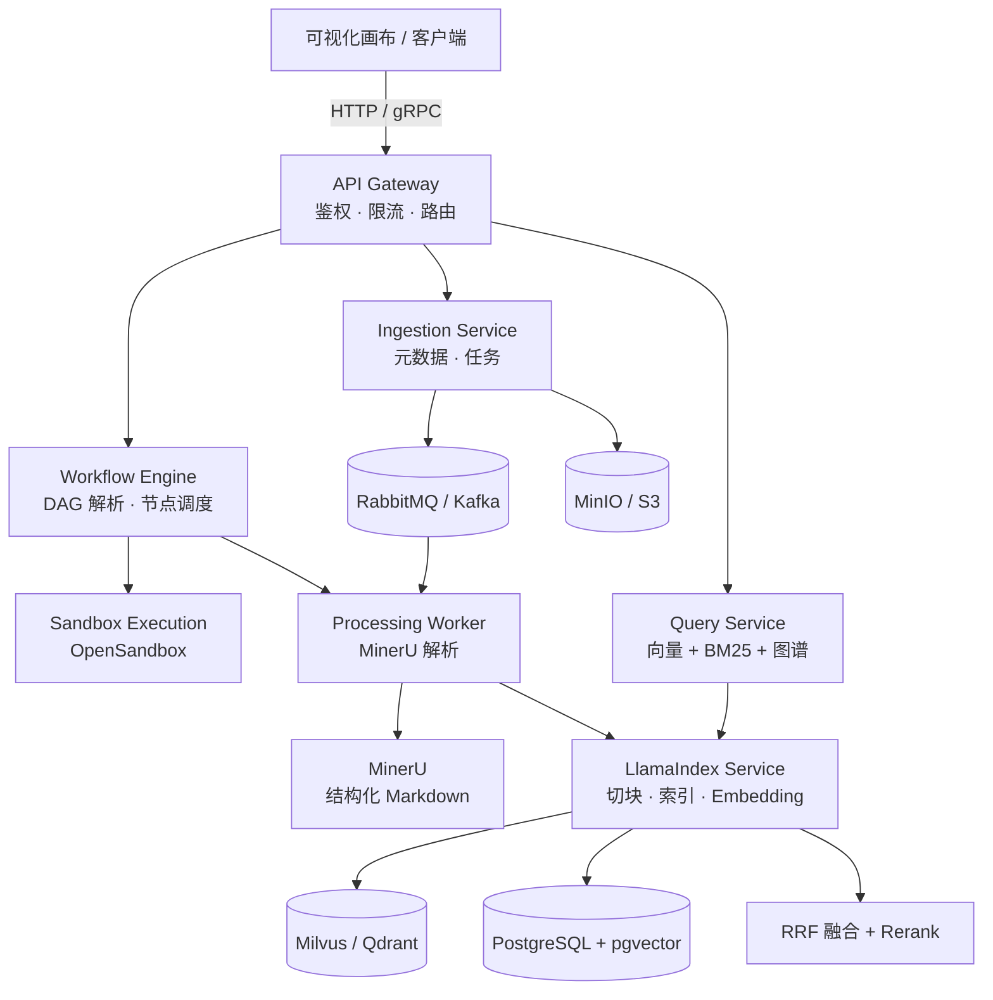

# NexusFlow

分布式文件向量化工作流：**Go 编排调度 + MinerU 解析 + LlamaIndex 数据加工 + OpenSandbox 执行**。

将 PDF / Word / TXT 等异构文件加工为可检索的向量与索引，提供多路召回、RRF 融合、Cross-Encoder 重排与自定义代码节点能力，服务下游 RAG 与语义检索场景。

完整设计见 [docs/architecture.md](docs/architecture.md)（系统架构设计文档 V4.0）。

> 说明：设计文档标题为 V4.0，正文部分沿用了 V2.0 的演进叙述（“V2.0 新增 LlamaIndex 服务”等），属于保留的历史上下文，不影响当前架构与代码结构。

## 架构总览



分层职责：

- **接入层**：Gateway 统一鉴权（JWT → tenant_id）、租户级限流、trace 透传。
- **编排调度层**：Workflow Engine 解析 DAG、按依赖并发调度；Ingestion 接收上传并投递任务。
- **执行加工层**：Processing Worker 调用 MinerU；LlamaIndex Service 负责语义/层级切块、索引与 Embedding；Sandbox Execution 经 OpenSandbox 执行自定义代码。
- **检索层**：Query Service 并行多路召回，RRF 融合，Cross-Encoder 重排，任一非核心路失败 Fail-open。
- **存储层**：MinIO 对象存储、Qdrant/Milvus 向量库、Redis 任务状态、PostgreSQL(+pgvector) 长期记忆。

## 服务与目录

| 服务 | 语言 | 目录 | 端口 | 职责 |
| --- | --- | --- | --- | --- |
| API Gateway | Go | `backend/cmd/gateway` | 8080 | 鉴权、限流、上传与检索入口 |
| Workflow Engine | Go | `backend/cmd/workflow-engine` | 8081 | DAG 校验与调度执行 |
| Ingestion Service | Go | `backend/cmd/ingestion` | 9095 | 上传登记、状态查询、任务投递 |
| Processing Worker | Go | `backend/cmd/processing-worker` | 9092 | 消费任务、调用 MinerU、发布解析结果 |
| Sandbox Execution | Go | `backend/cmd/sandbox-execution` | 9093 | 自定义代码节点强隔离执行 |
| Query Service | Go | `backend/cmd/query-service` | 9094 | 多路召回、RRF、重排、流式回答 |
| LlamaIndex Service | Python | `services/llamaindex` | 8000 | 切块、索引、Embedding、检索策略 |
| Web Console | React | `web` | 5173 / 8088 | 控制台：文件管理 / 任务中心 / 检索 / 沙箱 / DAG 编排 |

```text
.
├── proto/vectorization/v1/        # Protobuf 契约（跨语言唯一事实来源）
├── backend/
│   ├── cmd/                       # 7 个可执行入口（含单进程 dev-all）
│   ├── internal/
│   │   ├── gateway/               # 鉴权、限流、HTTP 路由
│   │   ├── workflow/              # DAG 校验、拓扑调度、节点注册
│   │   ├── ingestion/             # 上传登记与任务投递
│   │   ├── processing/            # MinerU 解析 Worker
│   │   ├── sandbox/               # Local / OpenSandbox 双后端
│   │   ├── query/                 # 召回、RRF、Rerank
│   │   ├── state/                 # 状态机（memory / Redis）
│   │   ├── queue/                 # 消息总线（memory / RabbitMQ）
│   │   └── platform/              # 日志、指标、HTTP/gRPC 服务封装
│   └── pb/                        # protoc 生成代码
├── services/llamaindex/           # FastAPI + LlamaIndex 数据加工服务
├── web/                           # React + TS 控制台（路由 + 多页面 + React Flow）
├── deploy/
│   ├── docker-compose.yml         # 完整本地编排
│   ├── k8s/nexusflow.yaml         # K8s 部署 + HPA 自定义指标
│   └── prometheus/                # 指标抓取配置
├── docs/architecture.md           # 架构设计文档（V4.0）
└── Makefile
```

## 快速开始

### 1. 单进程跑通全链路

无需任何外部依赖，单进程即启动 Gateway（:8080）、Workflow Engine（:8081）与全部 gRPC 服务，使用内存消息总线 + Mock MinerU：

```bash
make run-dev-all
```

然后：

```bash
# 1) 上传真实文件（multipart）——文件写入对象存储并登记任务
curl -s http://127.0.0.1:8080/v1/files -F "file=@./README.md"

# 或仅登记元数据（文件由客户端直传对象存储时使用）
curl -s http://127.0.0.1:8080/v1/files \
  -H 'Content-Type: application/json' \
  -d '{"file_name":"demo.pdf","file_type":"pdf","file_size":1024}'

# 2) 任务列表（按状态过滤 / 分页）
curl -s "http://127.0.0.1:8080/v1/tasks?limit=20"

# 3) 单个任务状态（task_id 换成上一步返回值）
curl -s http://127.0.0.1:8080/v1/tasks/<task_id>

# 4) 检索（内置演示语料）
curl -s http://127.0.0.1:8080/v1/search \
  -H 'Content-Type: application/json' \
  -d '{"query":"三路召回如何融合？","routes":[{"type":"vector","top_k":20},{"type":"bm25","top_k":20}],"final_top_n":5}'

# 5) 沙箱执行自定义代码（输入/输出走 /tmp/input.json、/tmp/output.json）
curl -s http://127.0.0.1:8080/v1/sandbox/execute \
  -H 'Content-Type: application/json' \
  -d '{"code":"print(1+2)","runtime":"python","timeout_seconds":10}'
```

DAG 校验与试运行：

```bash
curl -s http://127.0.0.1:8081/v1/workflows/validate \
  -H 'Content-Type: application/json' \
  -d '{"dag":{"name":"demo","nodes":[{"id":"ingest","type":"ingest"},{"id":"parse","type":"parse"}],"edges":[{"from":"ingest","to":"parse"}]}}'
```

### 2. 前端控制台

```bash
make web-install
make web-dev        # http://localhost:5173
```

控制台通过 Vite 代理连接 Gateway（`/api`）与 Workflow Engine（`/wf`），包含以下页面：

| 页面 | 路径 | 功能 |
| --- | --- | --- |
| 概览 | `/` | 任务统计、最近任务、快捷入口 |
| 文件管理 | `/files` | 拖拽/点击上传文件，查看处理状态 |
| 任务中心 | `/tasks` | 任务列表、状态过滤、自动轮询、详情 |
| 检索测试 | `/search` | 多路召回检索与结果展示 |
| 沙箱 Playground | `/sandbox` | 自定义代码执行与输入/输出合约调试 |
| 工作流编排 | `/workflow` | 拖拽节点、连线、DAG 校验与试运行 |

右上角「Token」可粘贴 JWT 切换租户身份；留空则匿名访问（需 `ALLOW_ANONYMOUS=true`）。

### 3. 完整容器编排

```bash
cp .env.example .env
make up
```

| 入口 | 地址 |
| --- | --- |
| Web 画布 | http://localhost:8088 |
| Gateway API | http://localhost:8080 |
| Workflow Engine | http://localhost:8081 |
| LlamaIndex Service | http://localhost:8000 |
| RabbitMQ 控制台 | http://localhost:15672 |
| Prometheus / Grafana | http://localhost:9090 / http://localhost:3000 |

容器编排使用 `STATE_DRIVER=redis`、`QUEUE_DRIVER=rabbitmq`，服务间通过 gRPC 与消息队列解耦。

## 核心机制

**任务状态机**（`backend/internal/state`）：

```text
PENDING → FETCHED → PARSING → PARSED → CHUNKED → EMBEDDED → INDEXED → COMPLETED
                                   ↘ FAILED（重试耗尽进 DLQ）

自定义节点：SANDBOX_CREATING → SANDBOX_RUNNING → SANDBOX_DONE → 并入主链路
```

消费端以 `task_id + content_hash` 为幂等键，避免重复解析与重复向量化。

**DAG 引擎**（`backend/internal/workflow`）：校验节点类型、引用完整性与环路，按拓扑层级并发执行就绪节点，上游输出写入共享 `ExecutionContext`。

**检索链路**（`backend/internal/query`）：多路召回并行执行 → RRF 融合（k=60）→ 去重 → Cross-Encoder 重排 → 取 top-N；单路失败或重排超时自动降级为 RRF 结果。

**沙箱护栏**（`backend/internal/sandbox`）：强制 TTL、`defer` 无条件销毁、输入/输出走约定文件、出口白名单与凭据不落盘。`local` 后端仅用于本机调试，生产必须使用 `remote`（OpenSandbox）。

## 开发者命令

```bash
make proto         # 重新生成 Go protobuf / gRPC 代码
make build         # 编译全部 Go 包
make test          # Go + Python 测试
make vet           # go vet
make web-build     # 前端类型检查与生产构建
make up / down     # 容器编排启停
```

## 当前实现边界

- `MINERU_TARGET` 为空时使用内置 Mock 解析器，便于本地闭环；接入真实 MinerU 只需配置该地址。
- Query Service 内置演示语料与内存召回；生产替换为 Qdrant/Milvus 召回器即可，RRF 与重排逻辑不变。
- LlamaIndex Service 的切块、索引与检索依赖 Qdrant 与 Embedding API Key；未配置时相关接口返回 503。
- K8s HPA 使用自定义指标 `nexusflow_queue_length`，需部署 prometheus-adapter 将指标转换为 Custom Metrics API。
- 设计文档中的 LightRAG、NL2SQL、长期记忆、Langfuse 章节属于目标架构，当前代码骨架预留了对应扩展位，尚未实现端到端链路。
